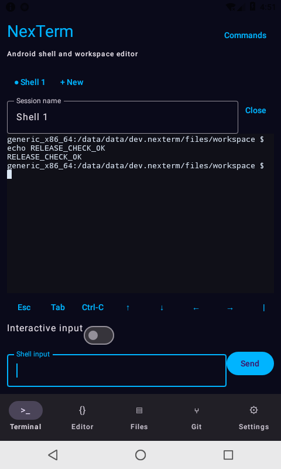

[](https://github.com/Cloud77077/app/actions)


[](https://github.com/Cloud77077/app/releases)
[](https://github.com/Cloud77077/app)

**Development implementation, not a production release.** The requested Termux/VS Code equivalent is not complete. Source is published at Cloud77077/app. The published APK is debug-signed for development; production signing is not configured.

## Contents
- [Features and status](#features-and-status)
- [Screenshots](#screenshots)
- [Installation](#installation)
- [Getting started](#getting-started)
- [Terminal reference](#terminal-reference)
- [Editor shortcuts](#editor-shortcuts)
- [SSH guide](#ssh-guide)
- [Building from source](#building-from-source)
- [GitHub Actions setup](#github-actions-setup)
- [Architecture](#architecture)
- [Contributing](#contributing)
- [License](#license)
- [Acknowledgements](#acknowledgements)

## Features and status
Implemented code (see validation status below):

- Terminal: JNI PTY creation, Android shell, multiple named sessions, close session, ordered nonblocking input, incremental UTF-8 decoding, selectable text, viewport-driven PTY resize and pinch font zoom. A bounded screen model handles basic cursor addressing, erase/insert/delete, scroll regions, alternate screen, cursor reports, and ANSI/256/RGB colors; history retains at most 10,000 lines.
- Background: foreground service with ongoing notification while sessions exist.
- Files: private workspace, directory navigation, file/folder creation, rename/move, confirmed recursive delete, refresh, and content search (200 results; files up to 1 MB). Moves reject overwrites and paths outside the workspace. Android document-picker import/export supports backing up individual text files (2 MB import limit).
- Editor: native Compose text editor, dirty indicator, atomic replacement on save, bounded undo/redo, case-sensitive find/replace, Ctrl+S/Z/Y/F, and an unsaved-edit confirmation when opening another file. Drafts survive tab switches and activity recreation through a ViewModel; process-death recovery is not implemented.
- UI: dark/light themes, cyan accents, bottom navigation, edge-to-edge insets, persistent screen-awake/font settings, command palette (Ctrl+Shift+P), and up to 50 locally saved shell snippets. Commands → Open Split shows terminal/editor panes side by side on wide windows or stacked on narrow windows.
- Build: API 26 minimum, API 35 target, CMake JNI, Gradle wrapper, release-signing configuration.

**Still incomplete:** full VT/xterm compatibility (including wide/combining-character cell layout, application cursor/keypad modes, mouse reporting and resize reflow); Linux/PRoot bootstrap; apt/pkg/pip/npm/gem; preinstalled development tools, Claude, gh, code-server or SSH; bundled fonts and terminal-specific selection handles; TextMate/Tree-sitter, LSP and diagnostics; Git status/operations/diffs/history; extensions or marketplace; JSON settings; minimap, multicursors, folding, bracket matching and formatting; breadcrumbs; SSH manager; cloud sync; clipboard history; process manager beyond shell session close; direct shared-storage tree editing; blur effects; tablet-specific layouts and animations.

This remains an unfinished development implementation, not a Termux or VS Code replacement. Basic VT handling does not establish compatibility with every full-screen application. Font zoom does not reflow historical lines. The buffered input field sends a complete line; enable **Interactive input** to forward edits as you type. Complex IME composition and editing after cursor-key movement need further device validation. Foreground services cannot guarantee survival after Android kills a process or the user force-stops the app. No Linux root filesystem is bundled.

## Validation status

For app commit [`3ace71c`](https://github.com/Cloud77077/app/commit/3ace71c), [CI run #13](https://github.com/Cloud77077/app/actions/runs/43908169241) passed both smoke tests on **Android API 26 and API 35**, with no skipped tests. These runs used x86_64 emulators; ARM hardware remains untested. They cover native PTY Unicode, kernel resize and SIGWINCH, Ctrl-C and shell exit, plus terminal color output, visible input controls, Unicode editor save, foreground registration before shell input appears, and closing a session. The same workflow passed unit tests, lint and debug assembly before publishing. The downloaded v0.1.13 APK was also cold-launched on the local API 26 VM: a complete command was verified in the input field, `echo RELEASE_CHECK_OK` produced the exact rendered output line, and Android reported the terminal service as foreground. Rapid ADB key injection initially truncated input; paced input was verified before the successful request.

Local checks passed **14 JVM tests**, lint, debug/test-APK assembly, and unsigned release APK/AAB assembly. An earlier local API 26 software-emulator run passed both smoke tests; a later cold UI run hit a Compose idling timeout while its native test passed. Local software-VM GUI results are not treated as equivalent to the successful current CI runs. The local API 35 software VM lost Android package/activity services during installation; **no app tests executed in that local run**. API 35 validation comes from the successful KVM-enabled CI job. Physical devices, full-screen app compatibility, complex IMEs, SAF import/export and every UI feature have not been exhaustively validated. Two existing manifest lint warnings remain.

Published: [**v0.1.13 — Development prerelease**](https://github.com/Cloud77077/app/releases/tag/v0.1.13), built from `3ace71c`. The downloaded APK matched `SHA256SUMS.txt`, its signature verified, and its manifest reports version code 13, minimum API 26 and target API 35. It is debuggable and uses a development signing key. These focused checks do not establish production readiness.

**Known issue in v0.1.10:** a cold terminal start reproduced Android’s foreground-service deadline crash on the slow local API 26 VM. The service-first startup flow shipped in v0.1.12; v0.1.13 also keeps the PTY slave open across `fork()` to prevent an early-read race. The current smoke suite starts the UI workflow first and asserts actual foreground status before shell input appears. Prefer v0.1.13 over v0.1.10.

Publication requires passing API 26/35 smoke tests, unit tests, lint and debug assembly. The workflow rejects missing, failed or skipped smoke tests and publishes only **Development prereleases**, including any artifacts signed with a persistent keystore.

## Screenshots
Actual API 26 software-emulator screenshot of the published v0.1.13 APK after the functional check. This is an unedited capture, not a mockup.



No Git-panel screenshot is supplied because Git integration is not implemented.

## Installation
Check the prerelease notes and checksums, then download its APK from Releases and permit your browser/file manager to install unknown apps. Install, launch NexTerm and select **Open terminal**. First launch creates a private workspace; it does not download Linux packages. Current builds are for development only.

## Getting started
Open a terminal, type `pwd` and tap Send. `ls`, `echo hello`, and Android toybox commands use the Android system shell. Use Files to create a file, tap it to open the editor, and Save to persist changes. The ⋮ menu renames, moves or deletes a file/folder. Search workspace searches text contents. Import file and Export editor use Android’s document picker; export important work before uninstalling. Imported files receive a unique name. Commands opens navigation commands and saved shell snippets; Run sends the selected snippet to the shell.

Package installation, `claude`, repository cloning and Git-panel commit/push workflows require the missing Linux bootstrap. No working instructions for those features can be supplied yet. When implemented, Claude will also require the user's own authentication with Anthropic.

## Terminal reference
Available commands are those supplied by the device's `/system/bin`, not a preinstalled Linux development toolchain. `git`, `python3`, `node`, `gh`, `claude`, `apt` and `pkg` are **not** supplied by this project. Toolbar: Esc, Tab, Ctrl-C, arrows, pipe, slash, dash, tilde, braces and semicolon. Hardware Enter and Up/Down send to the shell; Ctrl+C/D/Z/L/R send control characters while shell input is focused. Interactive input forwards typed edits immediately; buffered input sends the field on Send/Enter.

## Editor shortcuts
| Action | Current interface |
|---|---|
| Save | Save button |
| Open | Tap file in Files |
| Copy/paste | Android text field selection |
| Save / undo / redo | Ctrl+S / Ctrl+Z / Ctrl+Shift+Z or Ctrl+Y |
| Find / replace | Ctrl+F or Find / replace button |
| Command palette | Ctrl+Shift+P or Commands button |

## SSH guide
SSH client/server, key storage and forwarding are not yet implemented. Do not store private keys in repository files. Future integration needs host-key verification, secure key handling and explicit server startup controls.

## Building from source
Prerequisites: JDK 17 or 21, Android SDK platform 35/build-tools 35.0.0, NDK 27.0.12077973, CMake 3.22.1. Open this directory in Android Studio and let Gradle sync, or run:

```sh
git clone https://github.com/Cloud77077/app.git
cd app
sdkmanager 'platforms;android-35' 'build-tools;35.0.0' 'ndk;27.0.12077973' 'cmake;3.22.1'
./gradlew testDebugUnitTest lintDebug assembleDebug
./gradlew connectedDebugAndroidTest # requires a booted emulator or connected device
./gradlew assembleRelease bundleRelease
```

Set `ANDROID_HOME` or `sdk.dir` in an ignored `local.properties`. Release builds are unsigned unless all signing variables are supplied: `KEYSTORE_PATH`, `KEYSTORE_PASSWORD`, `KEY_ALIAS`, `KEY_PASSWORD`. Never commit the keystore or credentials. Install a debug APK using `adb install -r app/build/outputs/apk/debug/app-debug.apk`. Validate on API 26 and 35 devices before distributing.

## GitHub Actions setup
Configure repository Actions secrets `SIGNING_KEY` (base64 encoded keystore), `KEYSTORE_PASSWORD`, `KEY_ALIAS`, `KEY_PASSWORD`. Keep the keystore backed up securely: future updates require the same signing identity. With all four secrets present, the workflow builds and signs both release APK and AAB with Gradle. Without secrets, it publishes an installable debug-signed development APK only. Incomplete signing configuration fails explicitly. Development signing keys may change between runs, requiring an uninstall that deletes app-private data; export important files first. After API 26/35 emulator smoke tests, the workflow verifies APK signatures, attaches SHA-256 checksums and build artifacts, and publishes explicitly named Development prereleases on main pushes or semantic version tags. Main pushes use `0.1.<run_number>`; explicit tags must be `vMAJOR.MINOR.PATCH`. Version codes use the monotonically increasing workflow run number; reruns reuse that code. Avoid reusing release tags. PRs run validation without access to signing secrets. Keystore-signed artifacts are labeled `development-keystore-signed`; signing does not imply readiness. The local default version is `0.2.0-dev`. Releases stay prereleases until product readiness is established. Public Actions and Release pages verified the v0.1.10 publication; GitHub REST API access remains a separate cloud-network setting.

## Architecture
`Pty.kt` bridges to `pty.cpp`, which opens a pseudo-terminal, forks, establishes a controlling terminal and executes the Android shell. `Sessions` owns session state, serialized input and synchronized PTY closure; `TerminalScreen` parses a bounded VT subset and `TerminalView` renders styled rows; `TerminalService` registers foreground status before creating a PTY off the UI thread. The native parent keeps a slave descriptor open across `fork()` to prevent a premature EOF before the child starts. Compose hosts terminal output, navigation, file browsing and the native text editor. PTY handles live only in memory. LSP and Linux runtime modules are not present yet.

A production Linux bootstrap must use reviewed, hash-verified ABI-specific artifacts and respect Android executable-memory and app-data execution restrictions. It must map workspace paths consistently and recover safely from interrupted installations. Adding a download URL alone is insufficient. Reusing Termux components requires a separate license review; this project's MIT license does not relicense third-party code.

## Contributing
Open an issue describing expected behavior and device/API details. Keep credentials out of logs. Test PTY resize, Unicode, full-screen applications, lifecycle transitions, process reaping and storage errors. Add tests covering the actual implemented behavior. Track missing features above; don't replace them with nonfunctional controls.

## License
MIT for original source; see [LICENSE](LICENSE). Dependencies retain their respective licenses.

## Acknowledgements
Termux, libterm, JediTerm, code-server and Tree-sitter informed the requested design. They are not bundled or integrated in this implementation. Android, Kotlin, Jetpack Compose and Gradle provide the current build and UI foundations.
